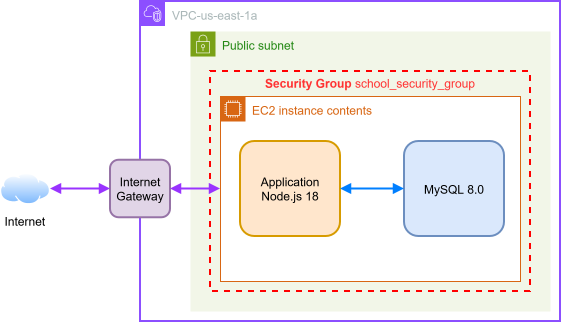

# TP

Réalisé par les étoiles flipantes (Juliann Merit et Adrien Dhommeaux)

## Phase 1 : Création d'une application web fonctionnelle de base

### Choix techniques

L'infrastructure est déployée avec Terraform dans la région `us-east-1`.

- **Réseau :** un VPC `10.0.0.0/16` contient un sous-réseau public `10.0.1.0/24` dans la zone `us-east-1a`.
- **Accès à Internet :** une Internet Gateway et une table de routage (`0.0.0.0/0` vers la gateway) relient le sous-réseau à Internet. Les utilisateurs accèdent ainsi à l'application, et l'instance peut télécharger le code et les bibliothèques nécessaires.
- **Serveur :** une instance EC2 `t3.medium` sous Ubuntu 24.04, avec une IP publique, héberge l'application et la base de données.
- **Sécurité :** le Security Group autorise en entrée HTTP (port 80) pour l'application et SSH (port 22) pour l'administration, depuis `0.0.0.0/0`. Tout le trafic sortant est autorisé. Le port MySQL n'est pas ouvert : l'application accède à la base en local.

Au premier démarrage, un script user data installe Node.js et MySQL, télécharge le code de l'application, crée la base `STUDENTS` et sa table, puis lance l'application sur le port 80.

### Résultats obtenus

L'application est accessible depuis Internet en HTTP : la page d'accueil et la liste des étudiants (`/students`) répondent correctement.
L'ajout, la modification et la suppression d'étudiant fonctionne.

### Problème rencontré

Nous utilisions initialement une AMI Ubuntu 26.04, qui installe MySQL 8.4. Dans cette version, le plugin `mysql_native_password` est désactivé par défaut, ce qui faisait échouer le script à la création de l'utilisateur de la base. Nous sommes donc passés à Ubuntu 24.04, qui installe MySQL 8.0.

## Phase 2 : Découplage des composants de l'application

